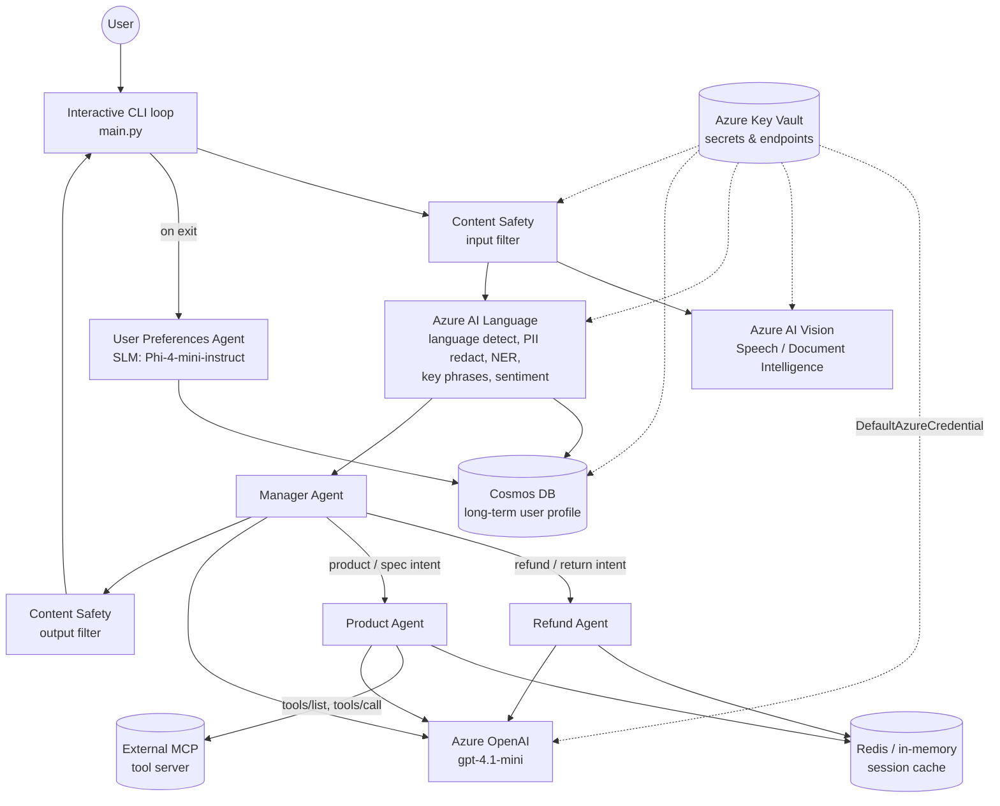
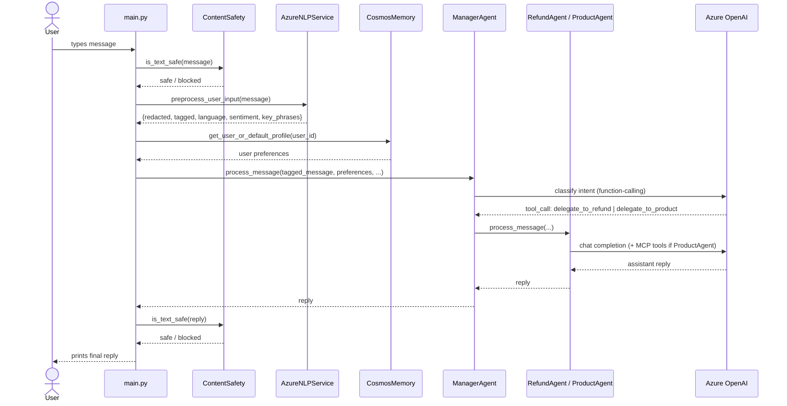

# Architecture

## Overview

This project is a multi-agent customer service system built on Azure AI Foundry. A **Manager Agent**
classifies each user message and delegates to one of two specialist agents (**Refund Agent**,
**Product Agent**), while a shared set of Azure AI services handles safety, language preprocessing,
multimodal understanding, and memory.

## System diagram

## Request lifecycle (single turn)

## Component responsibilities

| Component | File | Responsibility |
|---|---|---|
| `ManagerAgent` | [classes/manager_agent.py](classes/manager_agent.py) | Classifies intent via LLM function-calling; never answers directly, only routes |
| `RefundAgent` | [classes/refund_agent.py](classes/refund_agent.py) | Handles refund/return requests; builds persona + boundaries + behavior system prompt |
| `ProductAgent` | [classes/product_agent.py](classes/product_agent.py) | Handles product questions; discovers and calls tools on an external MCP server |
| `UserPreferencesAgent` | [classes/user_preferences_agent.py](classes/user_preferences_agent.py) | SLM (Phi-4-mini-instruct) that infers language/tone/email from conversation history |
| `ContentSafety` | [classes/content_safety.py](classes/content_safety.py) | Filters input/output against Hate, Sexual, Violence, SelfHarm severity thresholds |
| `AzureAIService` | [classes/azure_ai_services.py](classes/azure_ai_services.py) | Vision (image captions/OCR/tags), Speech-to-text, Document Intelligence extraction |
| `AzureNLPService` | [classes/azure_nlp_services.py](classes/azure_nlp_services.py) | Language detection, PII redaction, NER, key phrases, sentiment analysis |
| `CosmosMemory` | [classes/cosmos_memory.py](classes/cosmos_memory.py) | Long-term user profile storage (90-day TTL) |
| `RedisMemory` | [classes/redis_memory.py](classes/redis_memory.py) | Short-term conversation history (TTL-based), with in-memory fallback |
| `SecretManager` | [classes/secret_manager.py](classes/secret_manager.py) | Cached secret retrieval from Key Vault |

## Infrastructure (Bicep)

[main.bicep](main.bicep) provisions, following Cloud Adoption Framework naming (`<type-abbr>-<workload>-<env>-<region>[-<suffix>]`):

- **AI Foundry** (`Microsoft.CognitiveServices/accounts`, kind `AIServices`) with two model deployments:
  - `llm-gpt-41-mini-<env>` — `gpt-4.1-mini`, used by Manager/Refund/Product agents
  - `slm-phi-4-mini-<env>` — `Phi-4-mini-instruct`, used by the User Preferences agent
- **Content Safety**, **Vision**, **Speech**, **Document Intelligence**, **Language** Cognitive Services accounts
- **Cosmos DB** account/database/container for long-term memory (free tier, 90-day TTL, partitioned by `/userId`)
- **Key Vault** holding every endpoint/key the app needs, with RBAC-only access
- **RBAC role assignments**: `Key Vault Secrets User` and `Cognitive Services OpenAI User` granted to the deploying principal, since the app authenticates with `DefaultAzureCredential` (Azure CLI credential when run locally)

## Known limitation

`ProductAgent` calls an external MCP tool server (`MCP_SERVER_URL`) for product lookups. On networks with
TLS-inspecting corporate proxies, this call can fail with `CERTIFICATE_VERIFY_FAILED`. The agent degrades
gracefully in that case (responds without tool results) rather than crashing.
